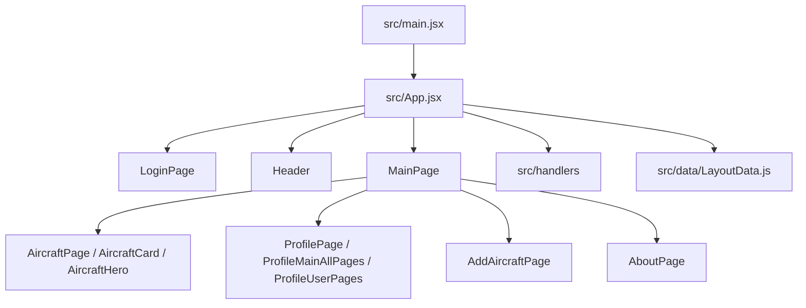

# AeroHangar code map

## Flow

## Entry points and state
- `index.html`: browser entry and viewport metadata.
- `src/main.jsx`: React mount and global CSS.
- `src/App.jsx`: login, active page, aircraft, likes, filters, and form state.
- `src/data/LayoutData.js`: sample aircraft and imported assets.
- `src/handlers/aircraftHandlers.js`: `createAircraftStateHandlers`.
- `src/handlers/aircraftCatalogHandlers.js`: catalog filtering/sorting helpers.

## Views
Components below live in `src/components/JSX/`.
- `MainPage.jsx`: selects active view and main scrolling container.
- `Header.jsx`, `HeaderButton.jsx`: main navigation.
- `LoginPage.jsx`: login screen.
- `Aircraft/`: catalog, cards, pagination, and detail overlay.
- `Profile/`: user header, profile tabs, and aircraft tiles/actions.
- `AddAircraft/AddAircraftPage.jsx`: shared add/edit form.
- `About/AboutPage.jsx`: about view.
- `Shared/Dialog.jsx`: shared dialog.

## Styling
Styles live in `src/components/CSS/`.
- `variables.css`: shared design tokens; imported by `index.css`.
- `index.css`: reset, growing root shell, document scrolling, modal scroll lock.
- `Main.css`: page wrappers in normal document flow (no nested page scroller).
- `Header.css`: navigation and narrow-screen wrapping.
- `AircraftPage.css`: catalog/cards, sticky page controls above cards on narrow
  screens plus controls after cards, and scrolling detail
  overlay with a single image gradient; `Aircraft.css` is empty.
- `Profile.css`, `ProfilePages.css`: profile layout, tabs, and tiles.
- `Login.css`, `AddAircraft.css`, `About.css`, `Dialog.css`: respective views.

## Validation
- `npm run dev -- --host 127.0.0.1`: local Vite development server.
- `npm run build`: production build.
- `npm run lint`: ESLint.
- Browser checks: login, catalog bottom/pagination, profile tabs, add form,
  and overlays at phone, tablet, desktop, and short landscape viewports.
